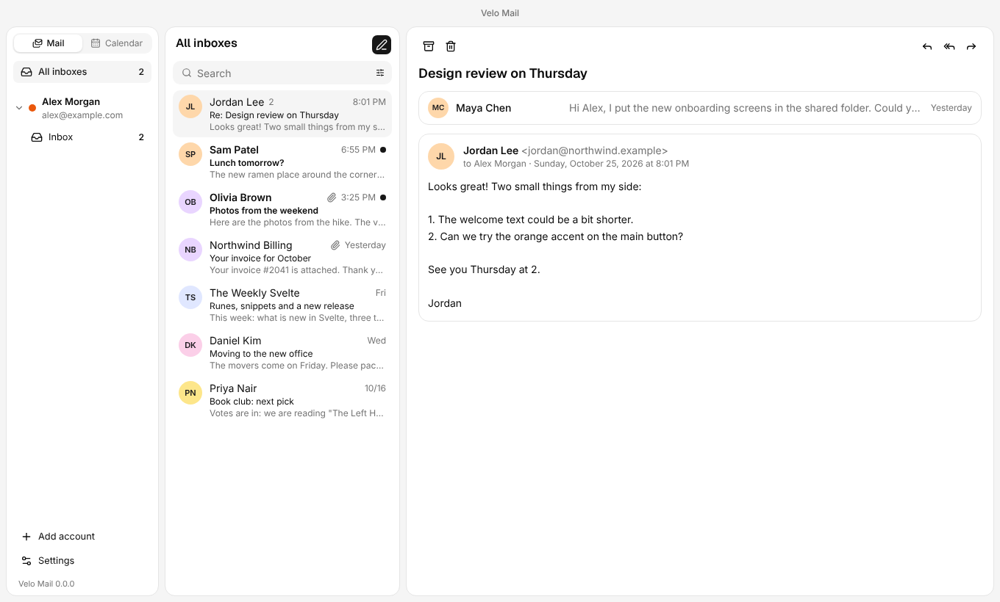
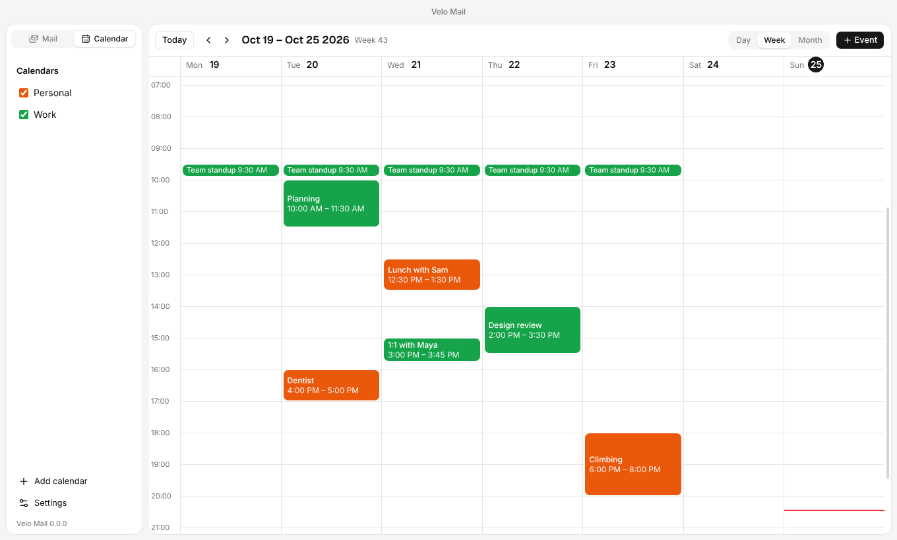
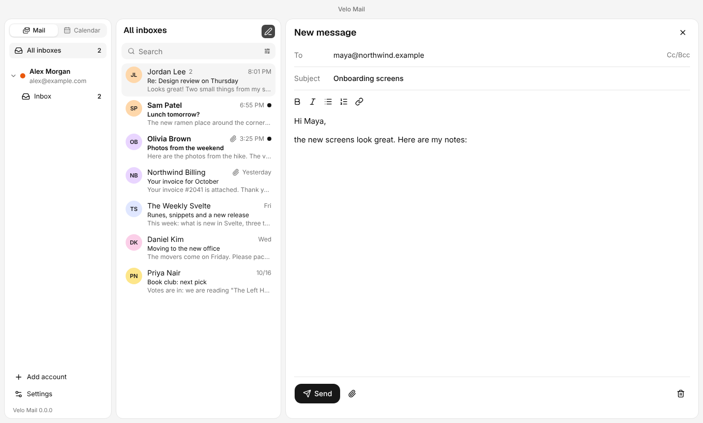
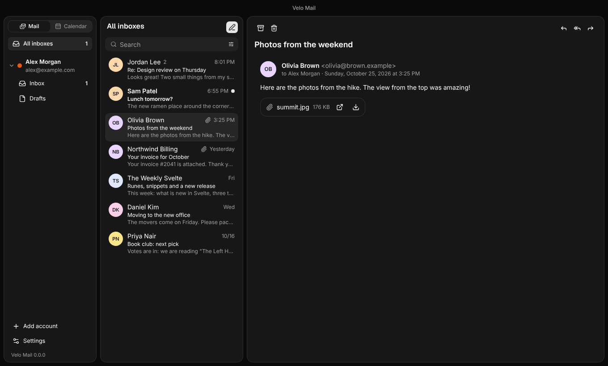

# Velo Mail

A lean desktop mail client with a simple, tidy interface, and a calendar
built in. Built with SvelteKit, shadcn-svelte, Drizzle, SQLite and Electron.



## Features

- **IMAP and SMTP accounts.** Server settings are looked up automatically.
  New mail arrives right away through IDLE, and mail is cached locally.
- **All inboxes in one list**, or one folder at a time. Conversations are
  grouped, and keyboard shortcuts move through them (j/k, r, a, f, e, #, c).
- **Search** across subject, sender and content. Filters narrow it by time,
  sender, account, attachments and unread mail, and the server is searched too.
- **Writing in the reading pane**, with formatting, attachments, signatures,
  drafts and address suggestions from the people who mailed you.
- **HTML mail shown safely.** It runs in a sandbox, and remote images are
  blocked until you allow them.
- **A calendar over CalDAV**, for example iCloud, Nextcloud, Posteo or Yahoo.
  It has day, week and month views. You can create, change and drag events,
  change single occurrences of a series, get reminders, and accept
  invitations from mail.
- **Notifications, a tray icon and an unread badge.** The app can keep running
  in the background.
- **Light and dark theme**, account colors, and folders you can pin.
- **English and German.** The app follows your system language, and you can
  switch it in the settings.
- **Updates from GitHub Releases.**

<table>
  <tr>
    <td></td>
    <td></td>
  </tr>
  <tr>
    <td align="center">Calendar</td>
    <td align="center">Writing a message</td>
  </tr>
</table>



## Install

Download the installer for your system from the
[latest release](https://github.com/Sniphs98/Velo-Mail/releases/latest):

- **Linux:** AppImage or deb
- **Windows:** Setup.exe
- **macOS:** dmg

The installers are not signed yet, so Windows and macOS warn you the first
time you start the app.

Gmail and Outlook need an app password for now. Sign-in with OAuth2 is planned.

## Development

You need Node.js 22 or newer. The integration and E2E tests also need Java 17
or newer for the test mail server, and Python 3 for the test calendar server.

```sh
npm install
npm run dev        # start the app with hot reload
```

| Command               | What it does                                                 |
| --------------------- | ------------------------------------------------------------ |
| `npm run dev`         | Vite and Electron; restarts when the main process changes    |
| `npm run dev:web`     | only the interface, in the browser (without `window.velo`)   |
| `npm run build`       | builds the interface into `build/` and Electron into `out/`  |
| `npm start`           | starts the built app                                         |
| `npm run package`     | builds an installer for your own system into `release/`      |
| `npm run lint`        | Prettier and ESLint                                          |
| `npm run check`       | type checks (svelte-check and Electron)                      |
| `npm run test:unit`   | unit and component tests (Vitest)                            |
| `npm run test:e2e`    | builds the app and tests it with Playwright                  |
| `npm run screenshots` | takes the pictures in this README (`docs/screenshots/`)      |
| `npm run i18n`        | compiles the translations (also runs on install and `check`) |
| `npm run db:generate` | creates a migration from changes to `electron/db/schema.ts`  |

The integration and E2E tests start
[GreenMail](https://greenmail-mail-test.github.io/greenmail/) as the IMAP and
SMTP server (`scripts/greenmail.mjs`) and [Radicale](https://radicale.org/) as
the CalDAV server (`scripts/radicale.mjs`). Both are installed into `.cache/`
on the first run. You don't need Docker.

On Linux without a display (servers, containers), run the E2E tests with
`xvfb-run -a npm run test:e2e`.

## Structure

```
electron/        main process and preload (Node, mail, calendar, database)
src/lib/api.ts   typed interface between the interface and the main process
src/             interface (SvelteKit, runs as an SPA in the window)
messages/        translations (en.json, de.json) for Paraglide JS
drizzle/         migrations (created with `npm run db:generate`)
e2e/             Playwright tests against the built app
scripts/         dev server, Electron build, test servers, version numbers
```

The database is SQLite through `node:sqlite`, which is built into Node and
Electron. There is no native module that has to be rebuilt for Electron. The
schema is in `electron/db/schema.ts`. After you change it, run
`npm run db:generate`. The app applies new migrations when it starts. The
database is `velo-mail.db` in the profile folder.

The interface has no access to Node. It gets everything it needs through
`window.velo`, which the preload provides from `src/lib/api.ts`.

### Translations

Texts are translated with [Paraglide JS](https://inlang.com/m/gerre34r/library-inlang-paraglideJs).
English is the base language.

1. Add a text to both `messages/en.json` and `messages/de.json`.
2. Use it as `m.key()`, or with values as `m.key({ name })`.
3. Import `m` from `#lib/paraglide/messages.js` in the interface. In the main
   process, import it by a relative path to `src/lib/paraglide/messages.js`.

The compiled files in `src/lib/paraglide/` are generated and not checked in.

The unit tests run in German (`src/lib/testing/german.ts`). Use `inLocale` to
test English. The E2E tests start the app with `--lang=de`.

## Releases

Every merge into `main` is released automatically. The label on the pull
request decides the version:

| Label          | Version              |
| -------------- | -------------------- |
| _(none)_       | patch, 1.2.3 → 1.2.4 |
| `feature`      | minor, 1.2.3 → 1.3.0 |
| `breaking`     | major, 1.2.3 → 2.0.0 |
| `kein-release` | no release           |

The pipeline builds installers for Linux (AppImage, deb), Windows (Setup.exe)
and macOS (dmg) and attaches them to the GitHub release.

The original project plan (in German) is in [PLAN.md](PLAN.md).

## License

[MIT](LICENSE)
